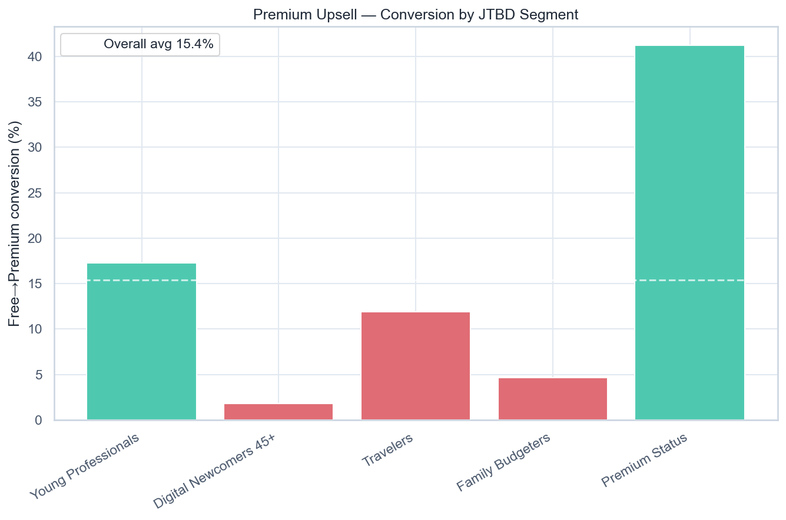

# Volta — Premium Upsell

[](https://github.com/NikitaBoyarkin/case-premium-upsell/actions/workflows/ci.yml)

[](LICENSE)

Free→Premium conversion concentrates in the anchor (17.3%) and status-seekers (41.2%); Digital Newcomers 45+ convert just 1.8% — the value prop doesn't transfer.

## Key results

- Premium Status 41.2%, anchor 17.3%
- Digital Newcomers 45+ 1.8% (z=34, p<0.001)
- The gap persists within cohorts

## Situation

The second Market & Jobs project: does the upsell found in the anchor transfer to new segments.

## Task

My job in the market and jobs layer was to check whether the upsell that worked for the anchor segment carries over to segments outside it.

## Actions

- Free→Premium conversion by JTBD segment and cohort.
- Chi² + z-test (anchor vs gap), driver importance (logistic regression).
- Offer-channel effect and top upgrade reason by segment.

## Result

- Conversion concentrates: **Premium Status 41.2%**, anchor **17.3%** vs **Digital Newcomers 45+ 1.8%** (z=34, p<0.001).
- The gap persists within every cohort (Power 26% vs Dormant 2%).
- Converters upgrade for different reasons — one upsell doesn't fit all.

## Recommendations

- Introduce segment offers: cashback for families, support for 45+, FX features for travelers.
- Don't expect parity with the anchor — plan for a residual gap.
- Test segment offers in an A/B (Project 20).

## Charts



## Dataset

The dataset is fully synthetic, generated by seeded, reproducible script(s) (`scripts/generate_premium_upsell_data.py`). No real customer data is used. Running `make data` regenerates the CSV(s) in `data/` with the same random seed, so every number below is reproducible.

## Quick start

```bash
uv sync --all-groups
make data
make run
```

## Project structure

```text
case-premium-upsell/
├── README.md
├── LICENSE
├── .gitignore
├── .python-version
├── pyproject.toml
├── Makefile
├── .github/workflows/ci.yml
├── scripts/
│   ├── generate_premium_upsell_data.py
│   └── volta_premium_upsell.py
├── utils/
│   ├── __init__.py
│   ├── common.py
│   └── viz_helpers.py
├── data/
│   └── volta_premium_upsell.csv
├── outputs/
│   ├── premium_upsell_conversion_by_segment.png
└── tests/
    └── test_premium_upsell.py
```

## Stack

- Python
- pandas / NumPy
- SciPy / Statsmodels
- scikit-learn
- Matplotlib / Seaborn
- uv + ruff

## Links

- [Full case study on the portfolio site](https://nikitaboyarkin.github.io/en/projects/volta/premium-upsell/)
- [Parent project — volta-banking](https://github.com/NikitaBoyarkin/volta-banking)
